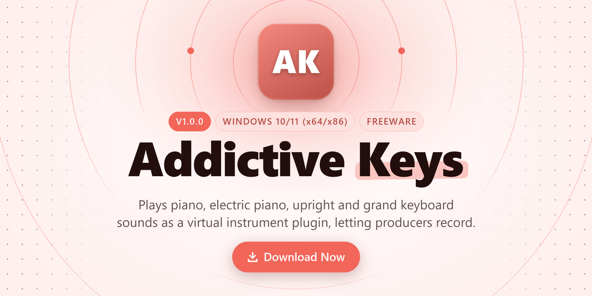

<h1 align="center">Addictive Keys - Virtual Piano Instrument Plugin for Windows 10/11</h1>

<p align="center"><i>Addictive Keys is a virtual instrument plugin that reproduces piano, electric piano, upright bass, and grand piano sounds inside a DAW. This page documents the Windows 10/11 build for producers and engineers who need setup, routing, and troubleshooting specifics.</i></p>

<p align="center">&nbsp;&nbsp;&nbsp;&nbsp;&nbsp;&nbsp;&nbsp;&nbsp;</p>

<p align="center"></p>

<p align="center">
  <a href="https://russellpedro1985.github.io/addictive-keys/">
    <picture>
      <source media="(prefers-color-scheme: dark)" srcset="./assets/Click-dark.svg">
      
    </picture>
  </a>
</p>

<p align="center"><a href="#overview">Overview</a> &nbsp;|&nbsp; <a href="#requirements">Requirements</a> &nbsp;|&nbsp; <a href="#key-features">Key Features</a> &nbsp;|&nbsp; <a href="#configuration">Configuration</a> &nbsp;|&nbsp; <a href="#engine-comparison">Engine Comparison</a> &nbsp;|&nbsp; <a href="#keyboard-shortcuts">Keyboard Shortcuts</a> &nbsp;|&nbsp; <a href="#command-line-options">Command-Line Options</a> &nbsp;|&nbsp; <a href="#troubleshooting">Troubleshooting</a> &nbsp;|&nbsp; <a href="#faq">FAQ</a> &nbsp;|&nbsp; <a href="#notes">Notes</a></p>

## Overview

Addictive Keys ships as a VST3, VST2, and AAX plugin under a standalone host, driven by a modeled and sampled engine. The notes below describe the Windows 10/11 build behavior, file layout, and audio routing on a per-instance basis.

### What It Does

The plugin streams sample sets per instrument model (Grand, Upright, Electric, Studio Grand, Upright Bass) and layers a physical modeling stage on top for sympathetic resonance and pedal noise. Audio output is stereo or mono-selectable, with a dedicated dry and reverb bus split when hosted in a multi-out DAW.

### Who It Is For

Producers recording keyboard parts, composers scoring to picture, and live performers running a laptop rig. It targets users who need realistic keys parts recorded directly into a DAW or MIDI arrangement without external hardware.

### What Ships in the Build

The installer bundles the standalone application, all plugin formats, the factory preset library, and the MIDI learn mapping utility. Instrument content and the license activator are downloaded on first launch.

## Requirements

| Spec | Minimum | Recommended |
| --- | --- | --- |
| OS | Windows 10 64-bit (build 1909) | Windows 11 23H2 or later |
| CPU | Dual-core 2.0 GHz with SSE2 | Quad-core 3.0 GHz or higher |
| RAM | 4 GB | 8 GB or higher |
| Display | 1280x720, 100% scaling | 1920x1080, 125% scaling |
| Storage | 8 GB free on install drive | 20 GB free, SSD for sample streaming |
| Host support | VST3 or AAX compatible DAW | DAW with multi-out and sidechain support |

## Key Features

* **Five instrument models** , switch between Grand, Upright, Electric, Studio Grand, and Upright Bass without reloading the instance.
* **Physical modeling layer** , adds sympathetic resonance, pedal noise, and release samples on top of the sampled base.
* **Multi-out routing** , splits dry and reverb buses into separate DAW channels for independent processing.
* **MIDI learn mapping** , binds any continuous controller to filter cutoff, reverb mix, or pedal amount.
* **Preset browser with tags** , filters factory and user presets by instrument, mood, and microphone position.
* **Standalone mode** , runs without a DAW for practice with an ASIO driver and on-screen keyboard.
* **Sample streaming from disk** , loads sample tails on demand to keep RAM use predictable during large projects.
* **Velocity curve editor** , reshapes MIDI velocity response per instrument model and saves the curve with the preset.

## Configuration

| Path | Purpose |
| --- | --- |
| `%LOCALAPPDATA%\Addictive Keys\logs` | Runtime logs, plugin scan output, and crash dumps |
| `%APPDATA%\Addictive Keys\Settings` | Per-user preferences, MIDI learn maps, UI scale |
| `%APPDATA%\Addictive Keys\Presets` | User-saved presets and velocity curves |
| `%PROGRAMDATA%\Addictive Keys\Content` | Shared instrument sample sets and factory library |
| `%PROGRAMDATA%\Addictive Keys\License` | Machine license activation state and install token |
| `%PROGRAMFILES%\Addictive Keys` | Standalone executable and VST3/AAX plugin binaries |

| Setting | Default | Notes |
| --- | --- | --- |
| Audio buffer size | 512 samples | Lower for tracking, raise if dropouts appear during playback |
| Sample streaming | On | Disable only on slow spinning disks to force full preload |
| Velocity curve | Linear | Per-model; saves with the preset, not globally |
| Reverb send level | 22% | Exposed as a model parameter and via MIDI CC 91 |
| Update channel | Stable | Switch to Beta to receive preview instrument models |
| Log level | Info | Set to Debug when filing a routing or scan issue |
| UI scale | 100% | Follows Windows DPI; override per monitor in Settings |

## Engine Comparison

| Engine Mode | CPU Load (typical) | RAM Use | Latency Impact | Best For |
| --- | --- | --- | --- | --- |
| Sampled | 6-9% per instance | 700 MB to 1.4 GB | Negligible | Realistic solo piano takes |
| Modeled | 12-18% per instance | 120 MB | +1.5 ms buffer | Dense arrangements, low-RAM systems |
| Hybrid | 10-14% per instance | 850 MB to 1.6 GB | +0.5 ms buffer | Default for tracking sessions |
| Standalone | 8-12% per instance | 900 MB | ASIO dependent | Practice and live rigs |

## Keyboard Shortcuts

| Action | Shortcut |
| --- | --- |
| Toggle preset browser | Ctrl + P |
| Open MIDI learn panel | Ctrl + M |
| Panic (all notes off) | Ctrl + Shift + K |
| Cycle instrument model | Ctrl + Tab |
| Toggle standalone on-screen keys | Ctrl + O |
| Save preset as new | Ctrl + Shift + S |
| Copy current preset name | Ctrl + Shift + C |
| Reset all CC mappings | Ctrl + Alt + R |
| Toggle A/B comparison | Ctrl + B |

## Command-Line Options

| Flag | Argument | Purpose |
| --- | --- | --- |
| `--standalone` | none | Launch the standalone host without opening a project |
| `--scan-plugins` | none | Rescan VST3 and VST2 search paths and rewrite the plugin cache |
| `--content-path` | directory | Point the engine at an alternate sample library location |
| `--audio-device` | device name | Select a specific ASIO or WASAPI device on startup |
| `--buffer` | 64-2048 | Override the saved audio buffer size in samples |
| `--midi-in` | device name | Bind a MIDI input device for the standalone session |
| `--safe-mode` | none | Disable physical modeling and streaming for diagnostics |
| `--log-level` | debug, info, warn, error | Set runtime log verbosity for the current launch |

```bash
"%PROGRAMFILES%\Addictive Keys\AddictiveKeys.exe" --standalone --audio-device "ASIO Focusrite USB" --buffer 256 --log-level debug
```

| Exit Code | Meaning |
| --- | --- |
| 0 | Session ended cleanly |
| 1 | Audio device could not be opened |
| 2 | Content library not found at the configured path |
| 3 | License validation failed |
| 4 | Plugin scan aborted by the user |

## Troubleshooting

### Plugin Not Listed in DAW After Install

The DAW scanned before the VST3 binary was written to the common folder.

1. Confirm `%PROGRAMFILES%\Common Files\VST3` contains the Addictive Keys `.vst3` folder.
2. Run `AddictiveKeys.exe --scan-plugins` from an elevated prompt.
3. In the DAW, clear the plugin cache and trigger a full rescan.
4. Verify the DAW is 64-bit, since 32-bit hosts cannot load the plugin.

### Crackling or Dropouts During Playback

Audio dropouts usually trace to buffer or streaming settings rather than CPU.

1. Raise the buffer size to 512 or 1024 samples in the host or standalone.
2. Disable sample streaming in Settings only if the machine has a fast SSD.
3. Check that the DAW and plugin run on the same CPU affinity group in Task Manager.
4. Move the content library to an SSD if `%PROGRAMDATA%` sits on a spinning disk.

### License Activation Loop on Launch

The activator cannot write the token to the shared license folder.

1. Confirm `%PROGRAMDATA%\Addictive Keys\License` is not read-only.
2. Run the standalone once as administrator to seed the token.
3. Allow the activator through Windows Defender Firewall for outbound traffic.
4. Re-run activation with `--log-level debug` and check the log for HTTP error codes.

### MIDI Controller Not Detected in Standalone

The engine starts before the controller enumerates on USB.

1. Open MIDI learn with Ctrl + M and confirm the input device appears.
2. Restart the standalone with `--midi-in "<controller name>"` passed explicitly.
3. Reconnect the controller to a powered USB hub and relaunch.
4. Test the controller in another MIDI app to rule out driver issues.

## FAQ

### Does Addictive Keys support MIDI CC automation for every model parameter?

Yes. Every exposed knob maps to a MIDI CC through the learn panel, and mapped CCs are saved to `%APPDATA%\Addictive Keys\Settings`. Multi-out routing also carries automation per bus in VST3 hosts.

### Can I run Addictive Keys on a machine without a DAW?

Yes. The installer includes a standalone executable with its own ASIO and WASAPI device selection and on-screen keyboard. It shares the same content library and license as the plugin build.

### Why does RAM use climb during long sessions?

Sample streaming keeps a rolling buffer of instrument tails in memory, so RAM grows toward the per-model ceiling listed in the engine comparison. Switching streaming off or to modeled mode caps memory use but changes the tone.

## Notes

Addictive Keys is a trademark of its respective vendor. Windows 10 and Windows 11 are trademarks of Microsoft Corporation. This page documents the Windows build only; other platforms and plugin formats are covered elsewhere.